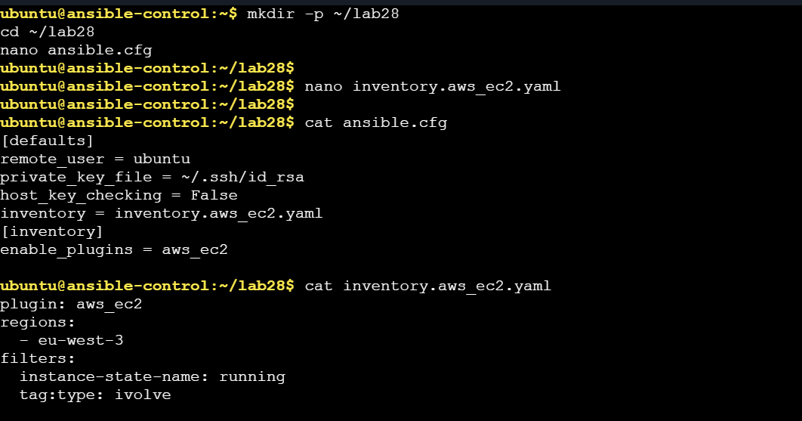
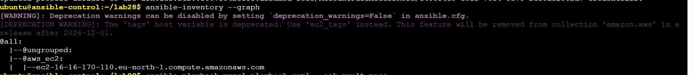

# Lab 28: Automated Host Discovery with Ansible Dynamic Inventory

**Course:** Red Hat Enterprise Linux Automation with Ansible (RH294)  
**Objective:** Discover a running AWS EC2 instance with Ansible dynamic inventory, run a playbook on it, and verify the configuration.

## Lab Requirements

- Create an EC2 instance tagged `server:ivolve`.
- Configure dynamic inventory to discover running instances with that tag.
- List target hosts with `ansible-inventory`.
- Run a playbook on the discovered instance.
- Verify the configuration on EC2.

## Environment

- **Control node:** `ansible-control` (Ubuntu)
- **Managed node:** AWS EC2 instance running Ubuntu
- **SSH user:** `ubuntu`
- **SSH key shown:** `~/.ssh/id_rsa`
- **Inventory plugin:** `aws_ec2`

The folder contains screenshots of the configuration and results. The actual Ansible configuration, inventory YAML, and playbook files are not included.

## 1. Prepare the Control Node

Install Ansible and the AWS inventory collection. Configure AWS credentials with permission to describe EC2 instances and ensure SSH access to the target.

```bash
ansible-galaxy collection install amazon.aws
mkdir -p ~/lab28
cd ~/lab28
```

## 2. Configure Ansible

The captured `ansible.cfg` contains:

```ini
[defaults]
remote_user = ubuntu
private_key_file = ~/.ssh/id_rsa
host_key_checking = False
inventory = inventory.aws_ec2.yaml

[inventory]
enable_plugins = aws_ec2
```

`remote_user` and `private_key_file` configure SSH access. The inventory setting points Ansible to the dynamic inventory source. The lab configuration disables host-key checking; for routine use, verify the host key and keep checking enabled.

## 3. Configure Dynamic Inventory

The screenshot shows this `inventory.aws_ec2.yaml`:

```yaml
plugin: aws_ec2
regions:
  - eu-west-3
filters:
  instance-state-name: running
  tag:type: ivolve
```

The state filter excludes stopped instances. **The captured tag filter is `type=ivolve`, while the lab brief requires `server=ivolve`.** To match the brief, tag the instance with key `server` and value `ivolve`, then use:

```yaml
filters:
  instance-state-name: running
  tag:server: ivolve
```

Set `regions` to the instance's actual AWS region. The screenshot specifies `eu-west-3`, but the discovered hostname contains `eu-north-1`; check this discrepancy before repeating the lab.

## 4. Discover the EC2 Host

From the directory containing both configuration files, run:

```bash
ansible-inventory --graph
ansible-inventory --list
```

The captured graph places one host in the `aws_ec2` group:

```text
@all:
  |--@ungrouped:
  |--@aws_ec2:
  |  |--ec2-16-16-170-110.eu-north-1.compute.amazonaws.com
```

This confirms host discovery with the captured inventory. It does not prove discovery using the required `server=ivolve` tag because the screenshot shows a different filter.

## 5. Run the Playbook

Test connectivity, then run the playbook:

```bash
ansible aws_ec2 -m ping
ansible-playbook YOUR_PLAYBOOK.yml
```

Replace `YOUR_PLAYBOOK.yml` with the actual file name. The playbook is not in this folder. The result screenshot shows a MySQL role installing MySQL, starting its service, creating a user and the `ivolve` database, and granting privileges.

## 6. Results and Verification

The captured play recap is:

```text
ec2-16-16-170-110.eu-north-1.compute.amazonaws.com : ok=6 changed=1 unreachable=0 failed=0 skipped=0 rescued=0 ignored=0
```

- **`ok=6`:** Six tasks completed successfully.
- **`changed=1`:** One task modified the instance.
- **`unreachable=0`:** Ansible connected to the instance.
- **`failed=0`:** No task failed.

The screenshot confirms the Ansible run, but does not show a separate on-host database check. Verify directly on the EC2 instance:

```bash
sudo systemctl is-active mysql
mysql -u ivolveuser -p
```

After entering the database user's password:

```sql
SHOW DATABASES;
USE ivolve;
SHOW GRANTS FOR CURRENT_USER();
EXIT;
```

Expected results are an active service, visibility of `ivolve`, and database privileges for `ivolveuser`. The output of these checks is not included in the provided evidence.

## 7. Screenshots

### Ansible Configuration and Dynamic Inventory

The configuration screenshot shows the SSH settings and EC2 inventory filters.



### Discovered EC2 Host

The inventory graph shows the EC2 host in the `aws_ec2` group.



### Playbook Result

The playbook screenshot shows the MySQL tasks and successful play recap.


## Conclusion

Lab 28 demonstrates automatic EC2 host discovery and a successful Ansible playbook run against the discovered instance: **6 OK, 1 changed, 0 unreachable, and 0 failed**. To fully meet the lab brief, change the tag filter to `server=ivolve`, confirm the region, and complete the on-host verification.
